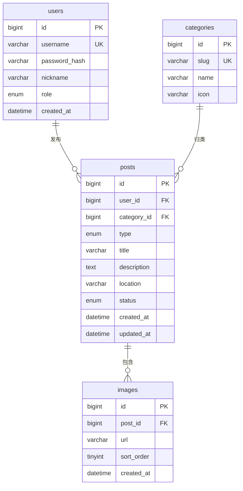

# 数据库设计

> 当前阶段：第 4 周，业务表与信息 CRUD API 已经落地。
> 本文件记录当前数据库设计、实际建表脚本和后续扩展方向。

## 实体关系



关系说明：

- 一个用户可以发布多条失物或招领信息。
- 一个分类可以对应多条信息。
- 一条信息可以关联图片。
- MVP 阶段每条规定最多上传一张图片，后续可以自然扩展为多张。

## users 用户表

| 字段 | 类型 | 约束 | 用途 |
| --- | --- | --- | --- |
| id | BIGINT UNSIGNED | 主键、自增 | 用户 ID |
| username | VARCHAR(30) | 唯一、非空 | 登录用户名 |
| password_hash | VARCHAR(100) | 非空 | bcrypt 密码哈希 |
| nickname | VARCHAR(50) | 非空 | 页面显示名称 |
| role | ENUM('user', 'admin') | 默认 user | 用户角色 |
| created_at | TIMESTAMP | 默认当前时间 | 注册时间 |
| updated_at | TIMESTAMP | 自动更新时间 | 最后修改时间 |

密码绝对不能以明文保存。第 3 周使用 bcrypt 后，`password_hash` 保存哈希值，不保存用户输入的密码。

## posts 信息表

| 字段 | 类型 | 约束 | 用途 |
| --- | --- | --- | --- |
| id | BIGINT UNSIGNED | 主键、自增 | 信息 ID |
| user_id | BIGINT UNSIGNED | 外键、非空 | 发布者 |
| category_id | BIGINT UNSIGNED | 外键、非空 | 物品分类 |
| type | ENUM('lost', 'found') | 非空 | 失物或招领 |
| title | VARCHAR(100) | 非空 | 物品名称 |
| description | TEXT | 非空 | 详细描述 |
| location | VARCHAR(100) | 非空 | 丢失或拾取地点 |
| status | ENUM('active', 'resolved', 'removed') | 默认 active | 信息状态 |
| created_at | DATETIME | 默认当前时间 | 发布时间 |
| updated_at | DATETIME | 自动更新时间 | 最后修改时间 |

`type` 和 `status` 分开保存：

- `type` 表示这是“失物”还是“招领”。
- `status` 表示信息目前是否有效、已解决或被管理员移除。

## categories 分类表

| 字段 | 类型 | 约束 | 用途 |
| --- | --- | --- | --- |
| id | BIGINT UNSIGNED | 主键、自增 | 分类 ID |
| slug | VARCHAR(30) | 唯一、非空 | 程序使用的英文标识 |
| name | VARCHAR(30) | 非空 | 页面显示的中文名称 |
| icon | VARCHAR(16) | 非空 | 分类图标 |

初始分类：

| slug | name | icon |
| --- | --- | --- |
| card | 证件 | 💳 |
| electronics | 电子设备 | 📱 |
| book | 书籍 | 📚 |
| key | 钥匙 | 🔑 |
| other | 其他 | 🎒 |

分类单独建表，便于后续增加新分类，而不需要修改 `posts` 表结构。

## images 图片表

| 字段 | 类型 | 约束 | 用途 |
| --- | --- | --- | --- |
| id | BIGINT UNSIGNED | 主键、自增 | 图片 ID |
| post_id | BIGINT UNSIGNED | 外键、非空 | 所属信息 |
| url | VARCHAR(500) | 非空 | 图片访问地址 |
| sort_order | TINYINT UNSIGNED | 默认 0 | 多图排序 |
| created_at | DATETIME | 默认当前时间 | 上传时间 |

数据库中不保存图片二进制内容，只保存文件地址。第 4 周图片文件会保存到上传目录或对象存储，数据库只记录 URL。

## MySQL 建表草稿

```sql
CREATE TABLE users (
  id BIGINT UNSIGNED AUTO_INCREMENT PRIMARY KEY,
  username VARCHAR(30) NOT NULL UNIQUE,
  password_hash VARCHAR(100) NOT NULL,
  nickname VARCHAR(50) NOT NULL,
  role ENUM('user', 'admin') NOT NULL DEFAULT 'user',
  created_at TIMESTAMP NOT NULL DEFAULT CURRENT_TIMESTAMP,
  updated_at TIMESTAMP NOT NULL DEFAULT CURRENT_TIMESTAMP
    ON UPDATE CURRENT_TIMESTAMP
) ENGINE=InnoDB
  DEFAULT CHARACTER SET utf8mb4
  COLLATE utf8mb4_0900_ai_ci;

CREATE TABLE categories (
  id BIGINT UNSIGNED AUTO_INCREMENT PRIMARY KEY,
  slug VARCHAR(30) NOT NULL UNIQUE,
  name VARCHAR(30) NOT NULL,
  icon VARCHAR(16) NOT NULL
) ENGINE=InnoDB DEFAULT CHARSET=utf8mb4;

CREATE TABLE posts (
  id BIGINT UNSIGNED AUTO_INCREMENT PRIMARY KEY,
  user_id BIGINT UNSIGNED NOT NULL,
  category_id BIGINT UNSIGNED NOT NULL,
  type ENUM('lost', 'found') NOT NULL,
  title VARCHAR(100) NOT NULL,
  description TEXT NOT NULL,
  location VARCHAR(100) NOT NULL,
  status ENUM('active', 'resolved', 'removed') NOT NULL DEFAULT 'active',
  created_at DATETIME NOT NULL DEFAULT CURRENT_TIMESTAMP,
  updated_at DATETIME NOT NULL DEFAULT CURRENT_TIMESTAMP
    ON UPDATE CURRENT_TIMESTAMP,
  CONSTRAINT fk_posts_user
    FOREIGN KEY (user_id) REFERENCES users(id)
    ON DELETE RESTRICT,
  CONSTRAINT fk_posts_category
    FOREIGN KEY (category_id) REFERENCES categories(id)
    ON DELETE RESTRICT,
  INDEX idx_posts_category_created (category_id, created_at),
  INDEX idx_posts_type_created (type, created_at),
  INDEX idx_posts_user_created (user_id, created_at)
) ENGINE=InnoDB DEFAULT CHARSET=utf8mb4;

CREATE TABLE images (
  id BIGINT UNSIGNED AUTO_INCREMENT PRIMARY KEY,
  post_id BIGINT UNSIGNED NOT NULL,
  url VARCHAR(500) NOT NULL,
  sort_order TINYINT UNSIGNED NOT NULL DEFAULT 0,
  created_at DATETIME NOT NULL DEFAULT CURRENT_TIMESTAMP,
  CONSTRAINT fk_images_post
    FOREIGN KEY (post_id) REFERENCES posts(id)
    ON DELETE CASCADE,
  INDEX idx_images_post (post_id, sort_order)
) ENGINE=InnoDB DEFAULT CHARSET=utf8mb4;
```

## 设计取舍

1. 类别使用 `categories` 表，不在 `posts` 中重复保存中文分类名，避免同一名称出现在多条记录中。
2. 图片单独建表，避免以后扩展多图时修改 `posts` 主表。
3. `password_hash` 替代明文密码，为第 3 周 bcrypt 做准备。
4. 管理员删除信息时，优先把 `status` 改为 `removed`，保留必要的数据记录；当前前端模拟阶段可以直接删除数组项。
5. 列表常用筛选条件预留组合索引，关键词搜索仍需在第 4 周根据数据量决定 `LIKE` 或全文索引。

## 第 3 周已实现接口

| 方法 | 地址 | 权限 | 用途 |
| --- | --- | --- | --- |
| POST | `/api/auth/register` | 公开 | 注册普通用户 |
| POST | `/api/auth/login` | 公开 | 校验密码并签发 JWT |
| GET | `/api/auth/me` | 需要 Bearer Token | 获取当前用户 |

安全措施：

- 密码使用 bcrypt 算法哈希后保存。
- JWT 默认有效期为 2 小时。
- JWT 令牌包含用户 ID、用户名和角色，不包含密码。
- `/api/auth/me` 会校验令牌并重新查询用户。
- 登录失败统一返回“用户名或密码错误”。
- 数据库密码与 JWT 密钥只保存在 `.env`，不提交到 Git。
